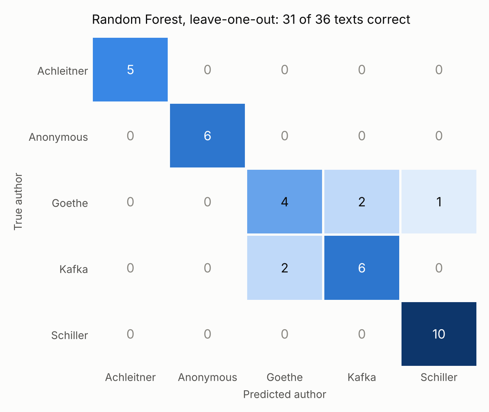
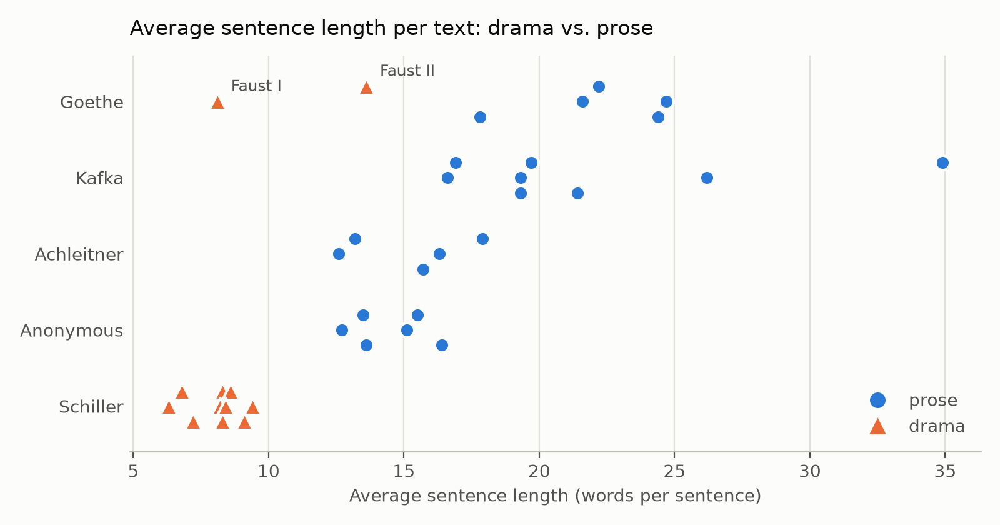
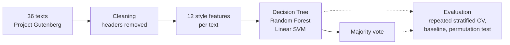

# Who wrote this? Authorship attribution for German literature

Can sentence length, punctuation and readability tell Goethe from Schiller? In this university project from 2025, I taught myself the basics of NLP, machine learning and author attribution, from the first chapters of the NLTK book to cross-validated classifiers, and later re-evaluated my own results more rigorously.


## At a glance

- **Task:** assign 36 public-domain texts to five authors (Goethe, Schiller, Kafka, Arthur Achleitner and an anonymous pulp series) using only *how* they are written, not *what* they are about.
- **Features:** 12 stylometric measures per text, including two German readability indices I implemented from scratch.
- **Models:** Decision Tree, Random Forest, linear SVM and a majority-vote ensemble (scikit-learn).
- **Result:** the Random Forest reaches **87% accuracy** in repeated stratified cross-validation, against a 28% majority baseline (permutation test p = 0.005).
- **Most interesting finding:** the models partly learned *genre* instead of *author*. All three classify Goethe's *Faust I* as Schiller.

## What I learned

| Area | What I did | Where |
|---|---|---|
| NLP fundamentals | NLTK book, chapters 1–2: tokenization, frequency distributions, concordances, collocations, n-grams, corpora (Gutenberg, Brown, Reuters), WordNet | [`learning/`](learning/) |
| Feature engineering | 12 style features from raw text: word and sentence length, syllables per word (Pyphen), type-token ratio, six punctuation rates | [`notebooks/01_feature_exploration.ipynb`](notebooks/01_feature_exploration.ipynb) |
| Computational linguistics | German readability indices (Flesch–Amstad, Wiener Sachtextformel) implemented by hand; explored POS tagging and NER with spaCy, word and character n-grams, function words | [`notebooks/01_feature_exploration.ipynb`](notebooks/01_feature_exploration.ipynb), [`learning/`](learning/) |
| Machine learning | Decision Tree, Random Forest, linear SVM, hard-voting ensemble; feature scaling and pipelines | [`notebooks/`](notebooks/) |
| Evaluation | From a single train/test split to repeated stratified cross-validation, majority baseline, permutation test, confusion matrices, precision/recall/F1 | [`scripts/evaluate.py`](scripts/evaluate.py) |
| Interpretability | Decision-tree visualisation, feature importances, 2-D decision boundaries | [`notebooks/`](notebooks/) |
| Data | Corpus built from Project Gutenberg (UTF-8, header removal, de-duplication); pandas, matplotlib, seaborn | [`data/`](data/) |
| Research practice | Feasibility study with a written report, literature research, ethics of stylometry (dual use) | [Ethics](#ethics) |

## Results

Repeated stratified 5-fold cross-validation (20 repeats) on 36 texts:

| Model | Accuracy (mean ± SD) | Macro-F1 |
|---|---|---|
| Majority baseline | 28% ± 1% | 0.09 |
| Decision Tree | 70% ± 16% | 0.66 |
| **Random Forest** | **87% ± 11%** | **0.84** |
| Linear SVM | 83% ± 11% | 0.82 |
| Linear SVM, 2 features (word + sentence length) | 70% ± 11% | 0.59 |
| Voting ensemble (DT + RF + SVM) | 86% ± 11% | 0.85 |

Permutation test (Random Forest): 84% accuracy with the real labels vs. 22% with shuffled labels, p = 0.005.

<p align="center">
  
</p>

### Findings

**1. The models partly learn genre, not author.** Every Schiller text in this corpus is a drama, and dramas consist of short dialogue lines. All 12 dramas average fewer than 14 words per sentence, all 24 prose texts more. As a result, the Decision Tree, the Random Forest and the SVM all classify Goethe's *Faust I* as Schiller in leave-one-out validation.



**2. Goethe vs. Kafka is the hard case.** Four of the Random Forest's five leave-one-out errors are Goethe ↔ Kafka confusions. Both write long, comma-heavy sentences, which these surface features cannot tell apart.

**3. The ensemble adds little.** On a single 8-text test split, the majority vote fixed every individual model's error (8 of 8 correct). Under repeated cross-validation it performs on par with the Random Forest alone.

### Original study vs. re-evaluation

| | Original study (2025) | Re-evaluation |
|---|---|---|
| Corpus | 38 texts | 36 texts (two duplicate Kafka texts removed) |
| Evaluation | one 80/20 split (8 test texts) + 10-fold CV without shuffling | repeated stratified 5-fold CV, baseline, permutation test |
| Random Forest | 87.5% (split), 72.5% (CV) | 87% ± 11% |
| Ensemble | 100% (8 of 8) | 86% ± 11% |

## Versions

| Version | What |
|---|---|
| `v1.0` | Cleaned up, corrected and re-evaluated |

## Lessons learned

- **Eight test texts are not an evaluation.** One text is worth 12.5 percentage points. The 100% ensemble result came from one lucky split.
- **How you split matters.** My first 10-fold CV ran on a file list sorted by author, without shuffling: one fold held out four of the five Achleitner texts. Stratified, shuffled and repeated folds fixed that.
- **Tune on validation data, never on training accuracy.** I first chose the SVM's hyperparameters by training accuracy. `gamma=1000` reached 100%, which is textbook overfitting.
- **Check the data before splitting.** Two Kafka stories were in the corpus twice, under different file names, which leaks information between training and test folds.
- **Look for confounds.** Genre (drama vs. prose) and text length (the type-token ratio drops as texts get longer) can masquerade as style.
- **Test hand-written formulas.** A `-` instead of a `×` in my Flesch formula went unnoticed for a while because the models still worked. A test against a known value would have caught it.

## How it works



### Corpus

| Author | Lived | Texts | What |
|---|---|---|---|
| Johann Wolfgang von Goethe | 1749–1832 | 7 | *Werther* (2 parts), *Die Wahlverwandtschaften*, *Wilhelm Meisters Lehrjahre* and *Wanderjahre* (vol. 1 each), *Faust I* and *II* |
| Friedrich Schiller | 1759–1805 | 10 | dramas only (*Die Räuber*, *Kabale und Liebe*, *Wallenstein*, …) |
| Arthur Achleitner | 1858–1927 | 5 | regional novels and stories |
| Franz Kafka | 1883–1924 | 8 | stories, novellas, *Der Process* |
| Anonymous | – | 6 | issues of the pulp series *Der Luftpirat und sein lenkbares Luftschiff* (1908–1911) |

Goethe and Schiller were included on purpose: they were close friends and influenced each other's writing.

### Features

| Group | Feature | Definition |
|---|---|---|
| Surface | Average word length | characters per word |
| | Average sentence length | words per sentence (NLTK sentence tokenizer) |
| | Syllables per word | Pyphen hyphenation dictionary (`de_DE`) |
| | Punctuation rates | `!` `?` `.` `,` `;` `:` per token (6 features) |
| Lexical | Type-token ratio | distinct tokens / all tokens |
| Readability | Flesch Reading Ease, German (Amstad) | 180 − ASL − 58.5 × ASW |
| | Wiener Sachtextformel (1st) | 0.1935 × MS + 0.1672 × SL + 0.1297 × IW − 0.0327 × ES − 0.875 |

ASL/SL: words per sentence · ASW: syllables per word · MS: % of words with three or more syllables · IW: % of words with more than six letters · ES: % of one-syllable words.

Content words were left out on purpose. The anonymous series mentions *Luft* constantly, and a model that learns topics would not generalise to other texts.

## Run it yourself

```bash
git clone https://github.com/tc020/german-authorship-attribution.git
cd german-authorship-attribution
python -m venv .venv
source .venv/bin/activate              # Windows: .venv\Scripts\activate
pip install -r requirements.txt
python -m nltk.downloader punkt_tab
python -m spacy download de_core_news_sm   # only for the exploration notebook

python scripts/evaluate.py             # results table and figures, about 2 minutes
jupyter lab                            # notebooks
```

## Repository structure

```
├── data/
│   ├── corpus/            # 36 cleaned texts, one file per work
│   ├── raw/               # original Project Gutenberg downloads
│   └── features.csv       # 36 × 12 feature table
├── notebooks/             # feature exploration, one notebook per model, ensemble
├── scripts/evaluate.py    # cross-validation, baseline, permutation test, figures
├── figures/
├── learning/              # how I got here: NLTK book exercises, playground, notes
└── requirements.txt
```

## Limitations and next steps

- **Small data.** 36 texts by five authors; results vary by about ±11 points between folds.
- **Chunks instead of whole books.** Splitting texts into segments of about 2,000 words, cross-validated by work, would give hundreds of samples. It would also answer the question that started this project: how short can a text be and still be attributed?
- **Classic stylometry features.** Function-word frequencies (Burrows' Delta) and character n-grams.
- **Genre balance.** Adding Schiller's prose (*Der Geisterseher*) and more Goethe dramas (*Egmont*, *Iphigenie auf Tauris*) would separate author from genre.
- **Vocabulary richness that doesn't depend on length**, such as MATTR instead of the type-token ratio.
- **A real open question.** The authorship of the *Luftpirat* series is disputed; one attribution names Oskar Hoffmann. That would be a fitting follow-up.

## Ethics

Stylometry is dual-use. The methods that attribute historical texts can also de-anonymise whistleblowers, activists or pseudonymous authors. Countermeasures (adversarial stylometry) exist and can be abused in turn, for example to imitate someone else's style. This project only uses public-domain literature.

## Data and license

The texts are in the public domain and come from [Project Gutenberg](https://www.gutenberg.org). The Gutenberg headers and license text were removed before the analysis. The code is released under the [MIT License](LICENSE).

## Author

**Timucin Cicek** · [GitHub](https://github.com/tc020)
<!-- optional: LinkedIn / e-mail -->
